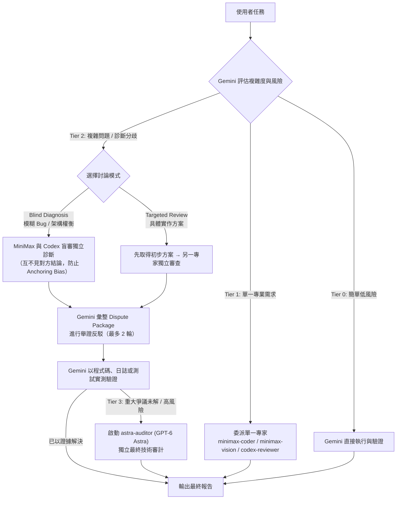

# AgentsCowork

**Selective Multi-Agent Collaboration Architecture（選擇性多代理協作架構）**

本專案提供一套可快速移植至各類軟體開發與研究專案的 **多 AI 代理協作架構**。它的核心價值不在於單純堆疊四個模型，而在於 **明確的職責分工（Tier 0–3）**、**防錨定盲審（Blind Diagnosis）** 與 **以證據為核心的雙向挑戰機制（Evidence-Based Cross-Challenge）**，讓模型之間互相檢驗假設，最後由實測證據定勝負。

---

## 核心設計理念

- **選擇性委派（Selective Delegation）**：依任務複雜度與風險動態決定調度層級，簡單任務由主代理直接處理，不浪費資源。
- **單一指揮權（Single Orchestrator）**：所有任務規劃、爭議彙整、實測驗證與最終交付皆由 Gemini 統一協調，嚴禁子代理私下無限互聊或遞迴呼叫。
- **不把共識當正確（Evidence Over Consensus）**：模型達成一致不代表結論正確；每項反對意見都須附帶檔案行號、日誌、反例或測試依據，且每個提案須主動列出 **Falsification Criteria（否證條件）**。
- **安全唯讀邊界（Read-Only by Default）**：外部 CLI 預設一律以唯讀沙盒模式執行，嚴禁互動模式與 `--yolo`，所有外部輸出均視為 Untrusted Output，須經主代理查核後才可寫入正式檔案。

---

## 四層協作架構（Tier 0–3）

| Tier | 模式 | 參與角色 | 適用情境 |
| :---: | :--- | :--- | :--- |
| **Tier 0** | **Gemini 自行處理** | Gemini | 簡單、低風險任務（語法修正、小型修改、文件與說明） |
| **Tier 1** | **單一專家** | MiniMax 或 Codex | 單一明確專業需求（程式碼分析／實作提案、視覺圖表判讀、獨立 Code Review） |
| **Tier 2** | **交叉討論** | Gemini + MiniMax + Codex | 複雜問題、診斷分歧、架構權衡（最多 2 輪，由 Gemini 主持 Dispute Package 互打） |
| **Tier 3** | **Astra 最終審查** | GPT-6 Astra | 高風險變更、重大未解爭議、關鍵架構決策或使用者明確要求 |

### 協作流程圖



---

## 角色職責與挑戰機制

| 角色 | 檔案位置 | 核心職責 | 挑戰與防呆約束 |
| :--- | :--- | :--- | :--- |
| **Gemini** | `GEMINI.md` | 主協調者（Primary Orchestrator）：規劃、分級、製作 Dispute Package、實測驗證與最終回報 | 禁止無控制代理互聊；強制以實測結果裁決分歧 |
| **minimax-coder** | `.agents/agents/minimax-coder.md` | 透過 `mcode exec` 進行程式分析、Bug 調查、重構與實作提案 | 內建 **Rebuttal Protocol**：禁止無證據盲目附和（Sycophancy），須逐點舉證捍衛或說明被何項證據說服 |
| **minimax-vision** | `.agents/agents/minimax-vision.md` | 透過 `mmx vision describe` 進行截圖、UI 判讀與圖表分析 | 嚴格區分「可見觀察」與「推論」，不憑空臆測模糊文字 |
| **codex-reviewer** | `.agents/agents/codex-reviewer.md` | 透過 `codex exec` 進行獨立 Code Review、並發與效能分析、第二意見 | 主動挑戰未驗證假設，須附帶可驗證依據與 Falsification Criteria |
| **astra-auditor** | `.agents/agents/astra-auditor.md` | 透過 `codex exec -m gpt-6-astra` 進行高推理獨立最終審計 | 不預設任何一方正確，挑戰所有方案的前提並標示殘餘風險 |

---

## 檔案結構

```text
.
├── GEMINI.md                              # 主協調規範、Tier 0–3 分級與 Dispute Package 協議
├── README.md                              # 架構說明文件
├── .gitignore                             # 排除本機測試檔與非架構圖片
└── .agents/
    ├── rules/
    │   └── external-clis.md               # 外部 CLI 共通安全紅線（always_on）
    └── agents/
        ├── minimax-coder.md               # MiniMax Code CLI 子代理定義與反駁協議
        ├── minimax-vision.md              # MiniMax Vision CLI 子代理定義
        ├── codex-reviewer.md              # OpenAI Codex CLI 獨立審查子代理定義
        └── astra-auditor.md               # GPT-6 Astra 最終審計子代理定義
```

---

## 快速移植至其他專案

1. **前置環境需求**：確認本機已安裝並登入以下外部 CLI（且位於系統 `PATH` 內）：
   - `codex`（OpenAI Codex CLI）
   - `mcode`（MiniMax Code CLI）
   - `mmx`（MiniMax Vision CLI）
2. **複製架構檔案**：將根目錄的 `GEMINI.md` 與整個 `.agents/` 資料夾複製到目標專案根目錄即可啟用。
3. **補充專案專屬資訊（選用）**：建議在目標專案的 `GEMINI.md` 底部補充該專案的測試指令（如 `pytest`、`npm test`）與環境規範，讓主代理能更精準地驗證各模型論點。
